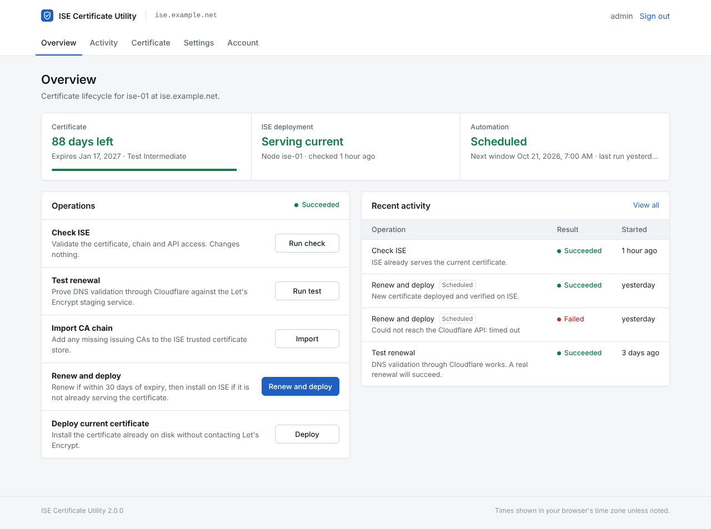

# ISE Certificate Utility

Automated, publicly trusted certificates for Cisco Identity Services Engine.

ISE Certificate Utility requests certificates from Let's Encrypt using DNS validation through the Cloudflare API, installs them on ISE through the OpenAPI certificate endpoints, and verifies the result. It runs as a small appliance (a Proxmox LXC container or any Debian/Ubuntu host) with a web console for setup, monitoring and manual operations.



## Features

- **Hands-off renewal.** Renews when the certificate enters a configurable threshold (30 days by default) and deploys only inside a maintenance window you define, with retries and weekday selection.
- **Safe ISE deployment.** Validates the certificate, chain and private key locally before touching ISE, imports the issuing CA chain into the trusted store, and imports the system certificate exactly once. An interrupted response is verified, never blindly retried.
- **EAP certificate protection.** Only the Admin and Portal roles are assigned. The EAP certificate is recorded before every import and checked afterwards; an optional fingerprint pin adds a hard stop.
- **Multiple names on one certificate.** Add portal FQDNs, other nodes or wildcards as subject alternative names, across any number of Cloudflare zones.
- **No inbound exposure needed.** DNS-01 validation means neither ISE nor this appliance has to be reachable from the internet.
- **Operations console.** Live status, operation log, history, certificate details and downloads, encrypted PFX export, and webhook notifications for Slack, Microsoft Teams or any JSON receiver.
- **Least privilege.** Runs as an unprivileged service account under a hardened systemd sandbox. Credentials are stored in mode 0600 files and never returned to the browser.

## Requirements

| Component | Requirement |
| --- | --- |
| Host | Debian 12 or later, or Ubuntu 22.04 or later, with systemd (a Proxmox unprivileged LXC works well) |
| Cisco ISE | 3.1 or later with the OpenAPI service enabled on the Primary Admin Node |
| ISE account | ERS Admin or Super Admin role |
| DNS | The ISE hostname and any additional certificate names must be in Cloudflare-managed zones |
| Cloudflare | API token with Zone:DNS:Edit and Zone:Zone:Read for those zones |
| Network | Outbound HTTPS to Let's Encrypt, Cloudflare and the ISE PAN |

## Quick start

```bash
apt-get install -y git
git clone https://github.com/Realishbird/ISE-CERT-UTILITY.git ise-cert-utility
cd ise-cert-utility
sudo ./install.sh
```

The installer creates the service account, installs the application into `/opt/ise-cert-utility`, prompts for a console password and prints the console URL with its certificate fingerprint. Open `https://<host>:8443`, sign in, and complete **Settings**. Then:

1. Run **Test renewal** to confirm Cloudflare DNS validation.
2. Run **Check ISE**, then **Import CA chain** if ISE does not yet trust Let's Encrypt.
3. Run **Renew and deploy** to issue the first certificate and install it.
4. Enable the maintenance window under **Settings** for automatic renewals.

See the [installation guide](docs/installation.md) for creating the LXC container and preparing ISE and Cloudflare.

## Documentation

| Guide | Contents |
| --- | --- |
| [Installation](docs/installation.md) | Proxmox container, ISE API account, Cloudflare token, installer, upgrades |
| [Configuration](docs/configuration.md) | Every setting explained |
| [Operations](docs/operations.md) | Renewal flow, CLI, maintenance windows, troubleshooting |
| [Architecture](docs/architecture.md) | Components, file layout and the deployment sequence |
| [Security](docs/security.md) | Threat model, secret handling and hardening |

## Command line

```text
ise-cert-utility status                 Certificate and deployment status
ise-cert-utility run check              Validate certificate, chain and ISE API access
ise-cert-utility run test-renewal       Staging dry run of DNS validation
ise-cert-utility run trust-chain        Import missing CAs into ISE
ise-cert-utility run renew --yes        Renew if due, then deploy
ise-cert-utility run deploy --yes       Deploy the current certificate
ise-cert-utility init --reset-password  Replace the console account
```

## Development

```bash
python3 -m venv .venv && . .venv/bin/activate
pip install -e '.[dev]'
pytest
ruff check .
```

The test suite includes a simulated ISE API, so no lab system is needed to run it.

## License

MIT. See [LICENSE](LICENSE). Cisco and Cisco ISE are trademarks of Cisco Systems, Inc. This project is not affiliated with or endorsed by Cisco, Cloudflare or Let's Encrypt.
